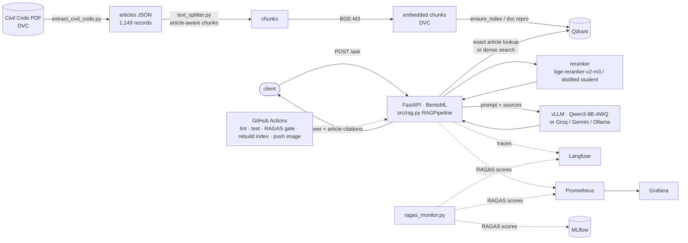
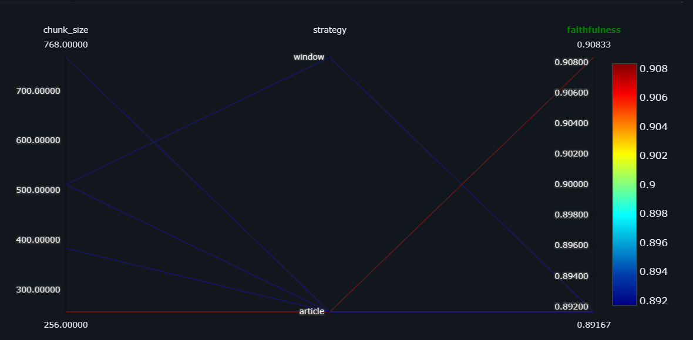
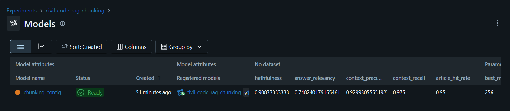
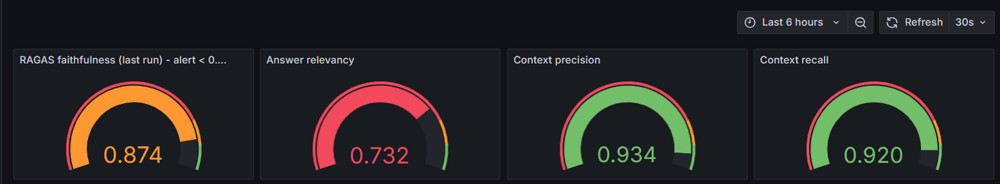

# Egyptian Civil Code — Arabic/English Legal RAG

Ask questions about the Egyptian Civil Code (Law No. 131 of 1948) in Arabic or English and get an
answer **with article citations** — never chunk ids. Hallucinations are unacceptable in legal work,
so every answer is generated only from retrieved articles, repealed articles are flagged, and
quality (RAGAS) is gated in CI and monitored in production.

```json
POST /ask   {"question": "ما هي شروط العقد؟"}
->          {"answer": "...", "sources": ["Egyptian Civil Code, Article 89", "Egyptian Civil Code, Article 90"]}
```

## Quick start (3 commands)

```bash
git clone https://github.com/AhmedYasser06/Egyptian-Civil-Code-RAG.git && cd Egyptian-Civil-Code-RAG
cp .env.example .env                                         # add GROQ_API_KEY (or GOOGLE_API_KEY) first
pip install numpy pyyaml && python -m src.scripts.fetch_data  # corpus + embeddings from the git snapshot data/release (no DVC remote needed)
docker compose up --build
```

Then (the first request downloads BGE-M3 and the reranker, ~4.5 GB, into a Docker volume):

```bash
curl localhost:8000/health
curl -s -X POST localhost:8000/ask -H 'Content-Type: application/json' \
     -d '{"question":"ما هي شروط العقد؟"}'
curl -N -X POST localhost:8000/ask/stream -H 'Content-Type: application/json' \
     -d '{"question":"What does Article 147 provide?"}'        # tokens arrive progressively
```

`docker compose` starts **Qdrant + the API**. The API image contains the DVC-tracked corpus and
embedded chunks; on start `src/scripts/ensure_index.py` loads them into Qdrant (idempotent).
`docker compose build --build-arg PRELOAD_MODELS=true` bakes the model weights in for offline start.
Fully local, no API key: `LLM_PROVIDER=OLLAMA`, or on a GPU `docker compose --profile gpu up`
with `LLM_PROVIDER=VLLM`.

## Architecture



| Layer | Choice |
|---|---|
| Corpus | PDF → structured JSON (one record / article, repealed flagged), DVC-tracked, validated by `tests/test_corpus.py` |
| Chunking | article-aware (never cuts across articles), configs compared in MLflow |
| Embeddings / rerank | `BAAI/bge-m3` / `BAAI/bge-reranker-v2-m3` (+ distilled student) |
| Vector DB | Qdrant (article number, book/chapter/section, repealed flag in payload) |
| LLM | Qwen3-8B-AWQ on **vLLM** (production), Groq / Gemini / Ollama (dev) |
| Serving | FastAPI `/ask` + **BentoML** (async, streaming) |
| Tracking / versioning | **MLflow** (runs + Registry), **DVC** |
| Quality | **RAGAS** (faithfulness, answer relevancy, context precision / recall) |
| Observability | **Langfuse** traces, Prometheus + Grafana, cosine drift, token cost, alerts |

## API

| Endpoint | |
|---|---|
| `POST /ask` | `{question}` → `{answer, sources}`. `question` ≥ 2 chars after trimming, else **422**. |
| `POST /ask/stream` | server-sent events: `token` … `sources` |
| `GET /health` | `{"status": "healthy", "documents_indexed": N}` (N = articles in Qdrant; 503 if Qdrant is down) |
| `GET /metrics` | Prometheus (latency per stage, tokens, cost, drift) |
| `GET /drift` | cosine drift of recent queries vs the reference set |
| `/api/v1/legal/*` | original v1 routes (kept) |

Package: `pip install -e .` then `civil-rag ingest` / `civil-rag query "..."` (`src/rag.py`).

## Experiments, data, CI

* **MLflow** — chunking sweep (5 configs: `chunk_size`, `overlap`, `embedding_model`, RAGAS
  `faithfulness` + 3 other metrics per run): `python -m src.mlflow.chunking_ragas_sweep` (run on a
  GPU, notebook `notebooks/kaggle_1_mlflow_ragas_sweep.ipynb`). Winner is registered as
  `civil-code-rag-chunking` (alias `production`, stage *Production*). `mlflow ui --backend-store-uri sqlite:///mlflow.db`
  → screenshots in `reports/`.

  Results (20 questions per config, Qwen3-8B as generator and RAGAS judge, `reports/chunking_sweep.json`):

  | config | chunks | faithfulness | answer relevancy | context precision | context recall | article hit rate |
  |---|---:|---:|---:|---:|---:|---:|
  | **article_256** (registered) | 2363 | **0.908** | 0.748 | 0.930 | 0.975 | 0.95 |
  | article_384 | 2299 | 0.892 | 0.743 | 0.923 | 0.975 | 0.95 |
  | article_512 | 2298 | 0.892 | 0.743 | 0.923 | 0.975 | 0.95 |
  | article_768 | 2297 | 0.892 | 0.743 | 0.923 | 0.975 | 0.95 |
  | window_512 | 2298 | 0.892 | 0.743 | 0.923 | 0.975 | 0.95 |

  Finding: Civil Code articles are short (mean ≈ 125 tokens), so for `chunk_size` ≥ 384 the splitter almost
  never cuts anything and those four configs produce (nearly) the same chunks and identical scores. Only 256
  actually splits long articles; it scores slightly higher, but with 20 questions the 0.016 gap is within noise.

  
  
* **DVC** — `data/raw/egyptian_civil_code.pdf` and every stage output are tracked;
  `git checkout <rev> && dvc pull && dvc repro` rebuilds the corpus, chunks, embeddings and the index.
  CI, Kaggle and Docker use the git snapshot `data/release/` instead of a DVC remote
  (`python -m src.scripts.fetch_data`; refresh it with `--make-release` after `dvc repro`).
* **CI/CD** (`.github/workflows/ci.yml`): ruff → pytest → **RAGAS gate** (fails if faithfulness < 0.75 on
  the 20-question set, or if the report is stale vs the corpus) → pull corpus + validate + rebuild Qdrant
  index → build, smoke-test and push the image to `ghcr.io/ahmedyasser06/egyptian-civil-code-rag`.

## Serving, load test, optimization

* **Serving**: vLLM (`Qwen/Qwen3-8B-AWQ`) + BentoML — `src/serving/bento_service.py`; see the module docstring.
  Streaming proof: `reports/streaming_demo.txt`.
* **Locust, 50 concurrent users**: `reports/locust_u50.html`, summary `reports/load_test.md`.

| run | endpoint | requests | failures | req/s | avg (s) | p50 (s) | p95 (s) | p99 (s) |
|---|---|---:|---:|---:|---:|---:|---:|---:|
| locust_u1 | /ask_json | 7 | 0 | 0.06 | 14.79 | 12.00 | 26.00 | 26.00 |
| locust_u50 | /ask_json | 380 | 0 | 1.27 | 33.38 | 26.00 | 71.00 | 146.00 |
| locust_stream_u20 | /ask | 39 | 0 | 0.67 | 3.23 | 1.90 | 6.90 | 7.10 |
| locust_stream_u20 | TTFT | 39 | 0 | 0.67 | 3.23 | 1.90 | 6.90 | 7.10 |

* **Optimization** (`notebooks/kaggle_2_optimization.ipynb`): AWQ 4-bit generator and a distilled
  re-ranker (568M → 118M params), RAGAS before vs after (`reports/quantization.md`,
  `reports/reranker_distillation.md`).

  **Quantization** — judge Qwen3-8B for every row, 30 questions, same retrieved contexts per reranker:

  | label | faithfulness | answer rel. | ctx prec. | ctx recall | p50 s | p95 s | tok/s | weights GiB/GPU |
  |---|---:|---:|---:|---:|---:|---:|---:|---:|
  | fp16 | 0.932 | 0.740 | 0.919 | 0.983 | 9.11 | 26.03 | 52.0 | 7.64 |
  | AWQ 4-bit | 0.972 | 0.720 | 0.915 | 0.983 | 10.72 | 41.28 | 58.8 | 2.85 |
  | AWQ + distilled reranker | 0.894 | 0.737 | 0.896 | 1.000 | 9.81 | 40.59 | 67.2 | 2.85 |

  AWQ cuts weight memory by 63% with no faithfulness loss (gate: drop ≤ 0.03, PASS). It is not faster on
  these T4 GPUs (p50 0.85×), probably because Turing lacks fast 4-bit kernels and both servers ran with
  `--enforce-eager`; the benefit here is memory (a 4-bit 8B model fits one T4). With 30 questions,
  differences of ~0.04 are within noise. The fp16 server ran with the custom all-reduce disabled (it crashes
  on T4s) and the AWQ server with it on, so the latency comparison is close but not strictly like-for-like.

  **Reranker distillation** — `bge-reranker-v2-m3` (teacher) → `multilingual-e5-small` (student), 20 retrieval questions:

  | reranker | R@1 | R@3 | R@5 | MRR | ms/query (mean) | ms p95 | params (M) |
  |---|---:|---:|---:|---:|---:|---:|---:|
  | no_rerank | 0.950 | 1.000 | 1.000 | 0.975 | 0 | 0 | 0 |
  | teacher | 1.000 | 1.000 | 1.000 | 1.000 | 226 | 242 | 568 |
  | student | 0.850 | 0.950 | 1.000 | 0.912 | 38 | 52 | 118 |

  The student is 5.9× faster and 4.8× smaller and keeps recall@5 on these 20 questions, but its top-1
  accuracy is lower (0.85 vs 1.00) and end-to-end faithfulness drops by ~0.08 (0.894 vs 0.972). Note that
  even with no reranking R@1 is already 0.95 on this small set, so the reranker's gain is modest here.

## Monitoring

RAGAS on ≥ 50 questions (all 4 metrics) → MLflow (trend across sessions), Prometheus/Grafana, and
every `/ask` is a Langfuse trace (`retrieval`, `generation` spans, tokens, cost) carrying its RAGAS
scores. Alert: faithfulness < 0.80. Setup and commands: [`docs/MONITORING.md`](docs/MONITORING.md).



## Operations

* **Batch re-indexing**: `python -m src.scripts.reindex_documents --input data/new/` chunks, embeds and upserts
  new/updated articles into the live collection (idempotent; verified by `tests/test_reindex.py`).
  Sample document: `data/new/sample_new_article.json`.
* **Canary rollout**: `docker-compose.canary.yml` + `deploy/canary/nginx.conf` split traffic 90/10 between
  the stable and the new image (CI tags every build `sha-<commit>`). Promote by editing the weight and
  `nginx -s reload`; roll back by setting 0/100. Kubernetes equivalent with automatic analysis
  (p95 latency, error rate): `deploy/canary/argo-rollout.yaml`.

## Development

```bash
pip install -e ".[dev]" && pytest -q && ruff check src main.py scripts tests
```

See [`CHANGELOG.md`](CHANGELOG.md) for the session-by-session history and
[`docs/COMPLETION_GUIDE.md`](docs/COMPLETION_GUIDE.md) for the build/run order.
